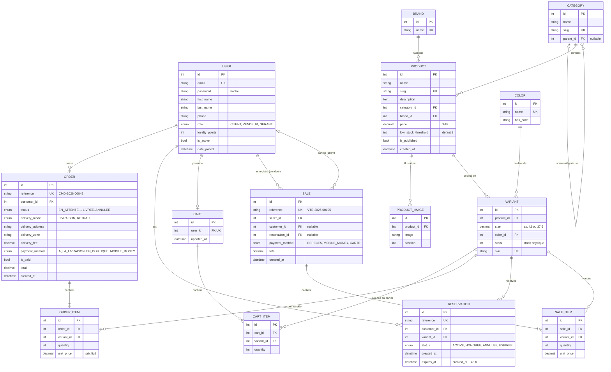

# Modèle de données — ShoeManager

Base de données **PostgreSQL**, gérée par l'ORM et les migrations de **Django**.

## Diagramme entité-association

## Choix de conception

- **Déclinaison (VARIANT)** : le stock n'est pas porté par le produit mais par chaque couple pointure/couleur. Contrainte d'unicité `(product_id, size, color_id)`.
- **Stock disponible calculé** (règle R2) : `stock − réservations ACTIVE − quantités des commandes EN_ATTENTE ou CONFIRMEE`. Il n'est pas stocké, pour éviter les incohérences ; il est calculé par une requête annotée.
- **Concurrence** : la validation d'une commande, d'une réservation ou d'une vente verrouille les lignes `VARIANT` concernées (`SELECT … FOR UPDATE`) dans une transaction, pour qu'une même paire ne soit jamais vendue deux fois.
- **Prix figés** : `ORDER_ITEM.unit_price` et `SALE_ITEM.unit_price` copient le prix au moment de l'achat.
- **Références lisibles** (`CMD-2026-00042`) pour les échanges avec les clients, en plus des identifiants techniques.
- **Catégories en arbre** : une simple clé `parent_id` (deux niveaux suffisent : Hommes › Baskets).
- **Montants** en `DECIMAL(12, 0)` : le franc CFA n'a pas de centimes.
- **Un seul modèle d'utilisateur** avec un rôle, plutôt que trois tables : plus simple pour l'authentification.
