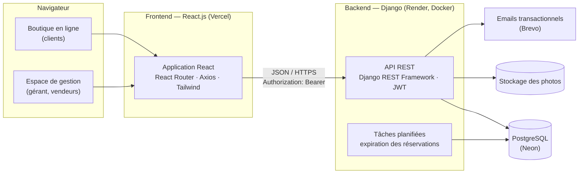
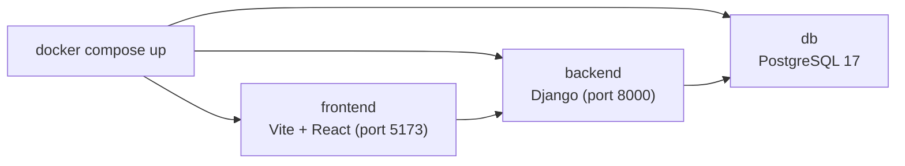

# Architecture — ShoeManager

## Vue d'ensemble



- Une seule application React contient la **boutique** (routes publiques `/`, `/produits/...`) et l'**espace de gestion** (`/gestion/...`, réservé au gérant et aux vendeurs).
- Le backend est une **API REST sans état** : chaque requête porte son jeton JWT.
- Les droits sont toujours vérifiés **côté serveur** ; l'interface ne fait que masquer ce qui n'est pas autorisé.

## Organisation du backend (applications Django)

```
backend/
├── config/            Réglages (dev, test, prod), URLs, WSGI
├── accounts/          Utilisateurs, rôles, inscription, JWT, mot de passe oublié
├── catalog/           Catégories, marques, couleurs, produits, déclinaisons, photos, stock disponible
├── cart/              Panier du client
├── orders/            Commandes, statuts, frais de livraison
├── reservations/      Réservations et expiration automatique
├── sales/             Ventes en boutique, reçus PDF
├── dashboard/         Statistiques
└── common/            Permissions, pagination, gestion des erreurs, emails
```

Chaque application contient : `models.py`, `serializers.py`, `views.py`, `urls.py`, `services.py` (règles métier : stock, transitions de statut) et `tests/`.

Les règles métier sont dans des **services** et non dans les vues : elles sont plus faciles à tester et réutilisées (une réservation honorée crée une vente avec le même code que la caisse).

## Principales routes de l'API

| Méthode | Route | Accès |
|---|---|---|
| POST | `/api/auth/register/` | Public |
| POST | `/api/auth/login/`, `/api/auth/refresh/` | Public |
| GET | `/api/categories/`, `/api/products/`, `/api/products/{slug}/` | Public |
| GET / POST / DELETE | `/api/cart/`, `/api/cart/items/` | Client |
| GET / POST | `/api/orders/` | Client (les siennes) |
| POST | `/api/orders/{id}/cancel/` | Client |
| GET / POST / DELETE | `/api/reservations/` | Client (les siennes) |
| GET / PATCH | `/api/manage/orders/`, `/api/manage/orders/{id}/status/` | Vendeur, gérant |
| GET / PATCH | `/api/manage/reservations/` | Vendeur, gérant |
| GET / POST | `/api/manage/sales/`, `/api/manage/sales/{id}/receipt.pdf` | Vendeur, gérant |
| CRUD | `/api/manage/products/`, `/api/manage/categories/`, `/api/manage/variants/` | Gérant |
| GET | `/api/manage/dashboard/`, `/api/manage/stock-alerts/` | Gérant |
| CRUD | `/api/manage/team/` | Gérant |

La documentation complète et interactive sera générée automatiquement (OpenAPI / Swagger, `/api/docs/`).

## Organisation du frontend

```
frontend/src/
├── api/               Client Axios (jeton, rafraîchissement, langue)
├── components/        Boutons, champs, cartes produit, filtres…
├── pages/shop/        Accueil, catalogue, fiche produit, panier, commande, mon compte
├── pages/manage/      Tableau de bord, commandes, réservations, caisse, produits, équipe
├── context/           Session et panier
├── i18n/              Français et anglais
└── utils/             Formats (XAF, dates), règles d'affichage
```

## Environnement de développement (Docker)



Un seul `docker compose up` lance la base de données, l'API et l'interface : chaque membre de l'équipe a exactement le même environnement.

## Qualité : TDD et intégration continue

1. **Rouge** : on écrit le test qui traduit un critère d'acceptation ; il échoue.
2. **Vert** : on écrit le code minimal pour le faire passer.
3. **Refactorisation** : on améliore le code, les tests garantissent qu'il fonctionne toujours.

- Backend : **pytest** + **pytest-django** ; frontend : **Vitest** + **Testing Library**.
- **GitHub Actions** lance les tests et le linter à chaque push et sur chaque pull request ; une pull request ne peut être fusionnée que si tout passe.

## Déploiement

| Service | Rôle |
|---|---|
| **Render** | API Django (image Docker), tâche planifiée d'expiration des réservations |
| **Neon** | PostgreSQL |
| **Vercel** | Application React |
| **Brevo** | Emails |
